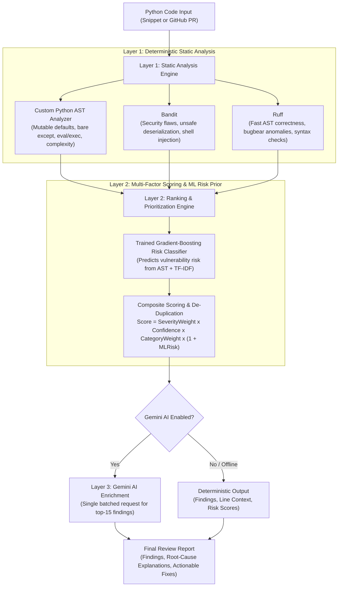
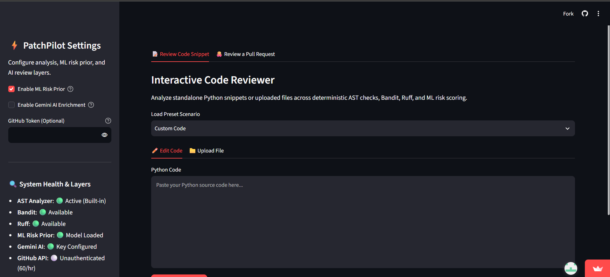
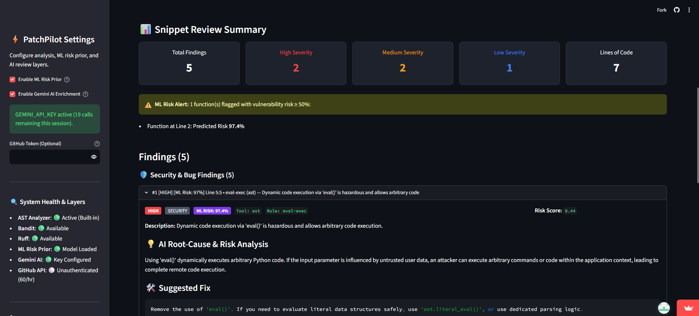

# ⚡ PatchPilot: AI-Powered Automated Code Review

> **Neural Storm 2026 Hackathon** | **Track:** Future Tech | **Problem FT-05:** AI-Powered Automated Code Review  
> [](https://www.python.org/)
> [](https://pytest.org/)
> [](LICENSE)

**Team:** rps (Rajasri A, Cheerla Praneetha, Madhira Sravanthi) · **Live demo:** https://patchpilot-v1.streamlit.app/ 

PatchPilot is a hybrid automated code review system for Python designed to detect subtle runtime bugs, security vulnerabilities, and architectural complexity before code is merged.

---

## 🎯 Problem Statement (FT-05)

Modern engineering teams face an ongoing trade-off in code review:
- **Human reviewers are overburdened**, frequently missing subtle security vulnerabilities, resource leaks, and complexity drift under tight release schedules.
- **Pure Linters produce high false-positive noise** without explanation or remediation, leading to alert fatigue where developers dismiss critical security notices.
- **Pure LLM reviewers hallucinate syntax rules**, lack deterministic reliability, are non-reproducible, and incur prohibitive token latency and cost when run indiscriminately across entire codebases.

---

## 💡 What PatchPilot Does: 3-Layer Hybrid Architecture

PatchPilot solves this by fusing deterministic static analysis with an empirical machine learning risk prior and targeted Gemini LLM enrichment:



1. **Layer 1: Deterministic Static Analysis**
   - **Custom AST Visitor**: Identifies mutable default arguments, bare `except:` blocks, hazardous dynamic execution (`eval`/`exec`), loose `== None` identity checks, cyclomatic complexity (>10 medium, >15 high), deep nesting (>4 levels), long functions (>50 lines), excessive parameter lists (>6 args), and syntax errors.
   - **Bandit**: Scans for known Python vulnerability patterns (injection, insecure deserialization, unsafe crypto).
   - **Ruff**: Fast static linter checking AST correctness, pyflakes (`F`), flake8-bugbear (`B`), and syntax anomalies (`E9`).

2. **Layer 2: Multi-Factor Scoring, De-Duplication & ML Risk Prior**
   - Ranks findings by a composite risk score:
     $$\text{Score} = \text{SeverityWeight} \times \text{Confidence} \times \text{CategoryWeight} \times (1 + \text{MLRisk})$$
   - **HistGradientBoosting Classifier**: Trained on non-test Python functions from PyCode-Vul, providing an empirical risk prior based on structural AST features and vocabulary.
   - **De-Duplication**: Merges overlapping alerts colliding on `(line, category)` so developers see only the highest-impact finding per line.

3. **Layer 3: Targeted Gemini AI Enrichment (`google-genai` SDK)**
   - Sends file context and top 15 prioritized findings in a **single batched JSON request** (temperature 0.2).
   - Explains the root-cause defect in plain English and proposes minimal, copy-pasteable production fixes.
   - **Resilient Fallback**: Operates completely offline with zero disruption when no API key is provided.

---

## ✨ Features

- **📝 Interactive Snippet Review**: Live editor with syntax highlighting, `.py` file drag-and-drop, and preset scenarios (*Vulnerable & Buggy*, *Complex & Deeply Nested*, *Clean Idiomatic Code*).
- **🐙 GitHub Pull Request Review**: Reviews any public PR URL, analyzes GitHub patch diffs, and surfaces findings **strictly on added or modified lines**.
- **🛡️ Pre-existing Issue Suppression**: Automatically hides findings located on unchanged lines in PR files, reporting a clear `"N pre-existing issues hidden"` count.
- **📦 100% Offline Demo Mode**: Bundled fictional sample PR (`octocat/demo-repo#42`) demonstrating SQL injection, shell execution, hardcoded secret, and bare except review without internet access or API keys.
- **🛡️ Tiered UI Display**: Shows **Security** and **Bug** findings openly by default; groups **Complexity** and **Style** smells into a collapsed `🛠️ Maintainability Issues` expander to eliminate alert fatigue.
- **🔍 System Health Self-Check**: UI sidebar monitors all 4 subsystems in real time: Static Analyzers, ML Model, Gemini AI, and GitHub Token status.

---

## 🌐 Live Demo & Screenshots

- **Live Deployment Link**: *https://patchpilot-v1.streamlit.app/*

### Application Screenshots

| Main Dashboard |
|:---:|
| <br>*(Caption: PatchPilot dashboard with the settings sidebar, system health check, and review summary)* |

| Interactive Snippet Review | GitHub PR Review (Diff-Filtered) |
|:---:|:---:|
| <br>*(Caption: Interactive snippet review showing security findings, risk scores, and Gemini AI root-cause analysis)* | <br>*(Caption: GitHub PR review mode displaying diff-filtered alerts on modified lines and hidden pre-existing issues count)* |

---

## 🛠️ Tech Stack & Libraries

- **Language**: Python 3.10+ (Tested on Python 3.13)
- **Static Analysis**: Python `ast`, `bandit` (v1.9.4), `ruff` (v0.17.3)
- **Machine Learning**: `scikit-learn` (v1.9.1), `joblib` (v1.6.0), `numpy` (v2.5.4), `pandas` (v3.1.0)
- **AI / LLM Integration**: Google Gemini via official `google-genai` SDK (v2.34.0)
- **Web Dashboard**: `streamlit` (v1.66.1)
- **REST API**: `fastapi` (v0.162.0), `uvicorn` (v0.54.0), `pydantic` (v2.14.2)
- **GitHub Integration**: GitHub REST API v3 via `requests` (v2.34.2)
- **Testing**: `pytest` (v9.2.0), `pytest-mock` (v3.17.0), `httpx` (v0.28.1)

---

## 🚀 Quickstart & Running Locally

### 1. Prerequisites
- Python 3.13 (tested); 3.10+ expected to work.
- Git

### 2. Clone and Setup Environment
```bash
# Clone the repository
git clone https://github.com/rjs236/PatchPilot.git
cd PatchPilot

# Create a virtual environment
python -m venv .venv

# Activate the virtual environment
# On Windows:
.\.venv\Scripts\activate
# On Linux / macOS:
source .venv/bin/activate

# Install dependencies (pinned for reproducibility)
pip install -r requirements-dev.txt
```

### 3. Environment Variables (Optional)
PatchPilot works with zero environment variables set (static and ML analysis run locally without network access). To enable optional Gemini explanations or higher GitHub rate limits, copy `.env.example` to `.env`:
```bash
cp .env.example .env
```
Configure your keys in `.env`:
```env
GEMINI_API_KEY=your_gemini_api_key_here
GEMINI_MODEL=gemini-3.5-flash

# Optional: Raises GitHub API rate limits from 60 req/hr to 5,000 req/hr
# GITHUB_TOKEN=your_personal_access_token_here
```
*(Tokens and keys are never stored, logged, or printed. When unconfigured, the app falls back gracefully to static + ML analysis and 60 req/hr unauthenticated GitHub queries).*

### 4. Running the Applications

#### Option A: Launch Interactive Streamlit Dashboard
```bash
streamlit run app/streamlit_app.py
```
Open [http://localhost:8501](http://localhost:8501) in your browser.

#### Option B: Start FastAPI REST Service
```bash
uvicorn patchpilot.api:app --host 0.0.0.0 --port 8000 --reload
```
Interactive API docs available at: [http://localhost:8000/docs](http://localhost:8000/docs)

**Sample Snippet Review API call:**
```bash
curl -X POST "http://localhost:8000/review" \
  -H "Content-Type: application/json" \
  -d '{"code": "def run(x=[]):\n    eval(x)\n", "filename": "vuln.py", "use_llm": false, "use_ml": true}'
```

**Sample Pull Request Review API call:**
```bash
curl -X POST "http://localhost:8000/review/pr" \
  -H "Content-Type: application/json" \
  -d '{"url": "https://github.com/octocat/demo-repo/pull/42", "use_llm": false, "use_ml": true}'
```

**Bundled Offline Demo PR Endpoint:**
```bash
curl -X GET "http://localhost:8000/review/pr/demo"
```

### 5. Running Automated Tests & Benchmark Smoke Test
```bash
# Run unit test suite (82 tests, runs locally without network access)
pytest -v

# Run benchmark smoke test (stratified sample of 100 functions)
python eval/benchmark.py --split split_a --sample 100 --output smoke_results.json
# The first run downloads PyCode-Vul from Hugging Face (internet required). Full run: --sample 0
```

---

## 📊 Empirical Evaluation & Benchmark Results

### 1. Headline Honest Summary
On the main benchmark, Bandit alone has higher F1 (0.768) than full PatchPilot (0.575) and higher recall; static PatchPilot reaches recall 0.905 but with a 49% false-positive rate caused mostly by maintainability rules; once the ML prior is applied with a validation-chosen threshold, full PatchPilot behaves much like the ML model alone.

On production (non-test) Python functions from PyCode-Vul, PatchPilot's gradient-boosting risk model reaches ROC-AUC 0.82 [0.80-0.84] and F1 0.46 [0.41-0.51] (at the default 0.5 threshold; 0.57 at the validation-tuned threshold used in the table below) on a cluster-isolated random split (N=2,236; 23% vulnerable; majority-class accuracy 76.9%), with recall of only 32% at the default threshold. On a held-out-repository split (N=1,052; 84 positives, mostly from two repositories) it reaches ROC-AUC 0.96 [0.94-0.98] and F1 0.73 [0.65-0.80]; this benchmark is small and imbalanced, so we treat it as supporting evidence only. Our audit found that 42% of the raw dataset were unit tests with a 74% vulnerable-label rate caused by fix-commit mining, and a trivial is_test baseline alone reached 0.70 AUC, so we removed tests, assertion counts and repository-identifying tokens from training. Labels remain noisy, and the model learns to separate vulnerable from patched code rather than to discover new vulnerabilities, so it is used only as a risk prior that re-ranks findings from Bandit, Ruff and custom AST checks.

### 2. Primary Benchmark Table: Split A Non-Test ($N=2,236$; 516 Vulnerable, 23.1%)

All decision thresholds were tuned on validation partitions to maximize F1 and applied frozen to held-out test splits without LLM calls:

| Setup | Precision | Recall | F1 Score [95% CI] | FPR (Clean) | ROC-AUC [95% CI] | PR-AUC | Runtime (ms/func) |
|---|:---:|:---:|:---:|:---:|:---:|:---:|:---:|
| **A. Bandit Alone** | **0.8198** | 0.7229 | **0.7683 [0.7365, 0.7964]** | **0.0477** | 0.8486 [0.8272, 0.8687] | 0.7361 | 43.3 ms |
| **B. Static PatchPilot** | 0.3554 | **0.9050** | 0.5104 [0.4839, 0.5372] | 0.4924 | 0.7612 [0.7385, 0.7829] | 0.4858 | 54.9 ms |
| **C. Full PatchPilot** | 0.6305 | 0.5291 | 0.5753 [0.5369, 0.6126] | 0.0930 | 0.8337 [0.8137, 0.8528] | 0.6501 | 60.4 ms |
| **D. ML Risk Prior Alone** | 0.6082 | 0.5446 | 0.5746 [0.5363, 0.6123] | 0.1052 | **0.8183 [0.7958, 0.8398]** | 0.6466 | **5.4 ms** |

### 3. Bandit Audit Limitation
Our audit revealed that **86.1% of Bandit's true positives on Split A came from generic constructs** rather than detection of the specific flaw patched in the commit: the top rules among true positives were B110 (try/except/pass, 181), B101 (assert, 149), B108 (hardcoded /tmp, 73), B311 (random, 49), B602 (subprocess shell=True, 47), and B324 (md5/sha1, 37). Consequently, the benchmark measures statistical agreement with commit-mined labels rather than detection of the specific vulnerabilities themselves.

### 4. Excluded-Unparseable Sensitivity Note
39 of 2,236 non-test functions in Split A (1.7%), all from sqlmap (with 0 in Split B), suffer from dataset truncation (AST syntax errors after dedent) that correlate with vulnerable labels (26 vulnerable vs. 13 clean, 66.7% positive rate vs 23.1% baseline). When these unparseable functions are excluded ($N=2,197$; 490 vulnerable, 1,707 clean), conclusions remain unchanged:
- **Bandit Alone**: Recall is 0.7612 (+0.0383), FPR 0.0480 (+0.0003), F1 0.7894 [0.7576, 0.8188] (+0.0211), ROC-AUC 0.8682 (+0.0196). (Bandit skips unparseable files, so 26 unflagged vulnerable samples drop out of the denominator).
- **Static PatchPilot**: Recall is 0.9000 (-0.0050), FPR 0.4886 (-0.0038), F1 0.4997 (-0.0107), ROC-AUC 0.7534 (-0.0078).
- **Full PatchPilot**: Recall is 0.5041 (-0.0250), FPR 0.0861 (-0.0069), F1 0.5588 [0.5208, 0.5973] (-0.0165), ROC-AUC 0.8301 (-0.0036).
- **ML Risk Prior Alone**: Recall is 0.5735 (+0.0289), FPR 0.1043 (-0.0009), F1 0.5922 (+0.0176), ROC-AUC 0.8223 (+0.0040).

Across Split B, 0 functions were unparseable (0 vulnerable, 0 clean). Relative findings and conclusions remain completely identical.

### 5. Exploratory: Category-Restricted Analysis (Security + Bug Only)

> [!NOTE]
> **Exploratory, added after reviewing the main results**: The primary benchmark evaluates all findings produced by the tools. Because AST complexity rules (`cyclomatic-complexity`, `long-function`, `too-many-args`) and style warnings flag structural characteristics rather than immediate vulnerabilities, this exploratory analysis isolates Setups B and C to only **security** and **bug** category findings (validation-tuned thresholds $B_{\text{sec}}=1.000, C_{\text{sec}}=1.271$ on Split A; $B_{\text{sec}}=1.000, C_{\text{sec}}=1.140$ on Split B):

| Split | Setup | Precision | Recall | F1 Score [95% CI] | FPR (Clean) | ROC-AUC [95% CI] | PR-AUC |
|---|---|:---:|:---:|:---:|:---:|:---:|:---:|
| **Split A Non-Test** | **B. Static (Sec + Bug)** | **0.7717** | 0.7403 | 0.7557 [0.7240, 0.7856] | **0.0657** | 0.8493 [0.8281, 0.8679] | 0.6690 |
| **Split A Non-Test** | **C. Full (Sec + Bug)** | 0.7495 | **0.7655** | **0.7574 [0.7263, 0.7861]** | 0.0767 | **0.8578 [0.8373, 0.8761]** | **0.7253** |
| **Split B Non-Test** | **B. Static (Sec + Bug)** | **0.6667** | **0.5476** | **0.6013 [0.5063, 0.6879]** | **0.0238** | 0.7524 [0.6984, 0.8061] | 0.4186 |
| **Split B Non-Test** | **C. Full (Sec + Bug)** | 0.6571 | **0.5476** | 0.5974 [0.5033, 0.6829] | 0.0248 | **0.7544 [0.7001, 0.8081]** | **0.4682** |

Restricting findings to security and bug categories on Split A reduces Static FPR from 49.2% to 6.6% (F1 rises from 0.510 to 0.756) and Full PatchPilot FPR from 9.3% to 7.7% (F1 rises from 0.575 to 0.757).

### 6. The Test-Function Discovery and Remediations
In commit-mined datasets (`PyCode-Vul`), 42.1% of samples were unit test functions, and 73.5% of test functions were labeled vulnerable because security fix commits frequently bundle regression tests. A trivial rule predicting `is_test -> vulnerable` alone achieved 0.700 ROC-AUC on Split A and 0.731 on Split B.
- **Remediations Enacted**:
  1. Filtered all test functions out of training, validation, and evaluation splits.
  2. Removed `num_asserts` from AST features.
  3. Excluded test-specific vocabulary from TF-IDF feature space.
  4. Built runtime guardrails (`is_test_function`) into `ml/inference.py` to prevent scoring unit tests.

*Full benchmark methodology, calibration curves, and error analysis are documented in [`docs/results.md`](docs/results.md).*

---

## 📁 Project Structure

```
PatchPilot/
├── app/
│   └── streamlit_app.py          # Interactive Streamlit dashboard
├── patchpilot/                   # Core application package
│   ├── analyzers/
│   │   ├── ast_analyzer.py       # Custom Python AST visitor & heuristics
│   │   ├── external.py           # Bandit & Ruff subprocess runners
│   │   └── models.py             # Finding dataclass & serialization
│   ├── api.py                    # FastAPI REST endpoints (/review, /review/pr)
│   ├── data/
│   │   └── demo_pr.json          # Fictional bundled sample PR data
│   ├── diff_utils.py             # Unified diff parser & line filtering
│   ├── github_pr.py              # GitHub REST API client & bounds enforcement
│   ├── llm.py                    # Gemini enrichment layer (google-genai)
│   ├── pipeline.py               # End-to-end review orchestrator
│   └── ranker.py                 # Multi-factor scoring & de-duplication
├── ml/                           # ML risk classifier & feature engineering
│   ├── artifacts/                # Frozen trained models & metrics (<1MB)
│   │   ├── baseline_model.joblib
│   │   └── baseline_model_clean.joblib
│   ├── features.py               # AST complexity & TF-IDF vectorizer
│   └── inference.py              # RiskPredictor runtime engine
├── eval/                         # Reproducible benchmark suite
│   ├── benchmark.py              # Evaluation runner for Setups A, B, C, D
│   ├── results.json              # Frozen Split A test metrics & CIs
│   └── results_split_b.json      # Frozen Split B test metrics & CIs
├── docs/                         # Documentation & submission artifacts
│   ├── AI_TOOLS.md               # AI tools disclosure log
│   ├── ARCHITECTURE.md           # System design & scoring specification
│   ├── results.md                # In-depth benchmark results & sensitivity
│   ├── screenshots/              # UI demo screenshots 
│   └── SUBMISSION_CHECKLIST.md   # Pre-deadline verification checklist
├── tests/                        # 82 automated unit & integration tests
├── .env.example                  # Environment configuration template
├── .gitignore                    # Comprehensive ignores (.env, datasets, caches)
├── LICENSE                       # MIT License
├── requirements.txt              # Pinned production dependencies
└── requirements-dev.txt          # Testing & development dependencies
```

---

## ⚠️ Limitations & Responsible Use

1. **Static Analysis & Heuristic Scope**: PatchPilot is an automated assistant, not a formal verification system. It can produce false positives (e.g. flagging complex but safe logic) and false negatives (e.g. distributed race conditions or novel business-logic flaws).
2. **Commit-Mined ML Labels**: The ML risk classifier is trained on historical security fix commits and identifies patterns characteristic of pre-patch vs. post-patch code. It serves as an empirical risk prior to re-rank static findings, not as a standalone vulnerability oracle.
3. **Privacy & Data Security**:
   - Code is analysed in temporary files that are deleted immediately and PatchPilot does not store it. If you enable LLM explanations, the code and findings are sent to Google's Gemini API, so do not use private code without permission.
   - When LLM explanations are disabled, PatchPilot runs locally without external API calls, except fetching PR data from GitHub.
4. **Human Review Required**: All AI-suggested code fixes must be inspected, tested, and reviewed by human engineers before merging into production repositories.

---

## 🤖 AI Disclosure

In accordance with Neural Storm 2026 hackathon guidelines, all AI assistance is logged in [`docs/AI_TOOLS.md`](docs/AI_TOOLS.md):
- **Google Antigravity Agent**: Utilized during development for project scaffolding, AST rule implementation, benchmark test automation, and documentation formatting.
- **Google Gemini (`google-genai` SDK)**: Utilized at runtime in Layer 3 to provide plain English root-cause diagnosis and code remediations.

---

## 👥 Team

- **Team Name**: `rps`
- **Members**:
  - `RAJASRI A; CHEERLA PRANEETHA; MADHIRA SRAVANTHI`

---

## 📚 Dataset Attribution & License

- **PyCode-Vul**: function-level data mined from security-fix commits of open-source Python projects.
  - Source: [`S-AIR-L/PyCode-Vul`](https://huggingface.co/datasets/S-AIR-L/PyCode-Vul) (Hugging Face Datasets), by the Security & AI Research Lab (S-AIR-L)
  - Dataset Licence: [CC BY 4.0](https://creativecommons.org/licenses/by/4.0/) (per the dataset card). PatchPilot's trained model and evaluation use this data; no dataset files are redistributed in this repository.
- **Software License**: PatchPilot is released under the [MIT License](LICENSE).
